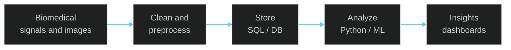

<div align="center">


<br/>


<br/><br/>



</div>


```text
krishnavel@kriz-tech:~$ neofetch

KRISHNAVEL P @ kriz-tech
────────────────────────────────────────
Degree ....  B.E. Biomedical Engineering
Class of ..  2027
Target ....  Data Analyst / Data Engineer
Domain ....  Healthcare & Biomedical Data
Languages .  Python, C, C++, MATLAB
Learning ..  SQL, Pandas, ETL, BI
Status ....  Open to opportunities
```


I'm a **Biomedical Engineering student** aspiring to become a **Data Analyst or Data Engineer**, with a focus on healthcare and biomedical applications.

I enjoy working with programming, physiological signals, medical images and data-driven systems. My goal is to combine biomedical domain knowledge with analytics and engineering to turn complex data into useful insights.

```yaml
interests:
  - Biomedical signal processing & medical imaging
  - Data analysis, statistics & visualization
  - Data pipelines, ETL & database systems
  - Healthcare interoperability (HL7 / FHIR)
currently:
  - Strengthening Python, SQL and data engineering skills
```


<div align="center">

**Programming & Scientific**<br/>


**Web & Dev Tools**<br/>


**Embedded & Interactive**<br/>


</div>

**Currently learning:** SQL · Pandas · data cleaning · EDA · ETL pipelines · data modeling · business intelligence





| Project | What it explores | Technologies |
|:--|:--|:--|
| [**BreathTrack**](https://github.com/kriz-tech/BreathTrack) | Respiratory effort sensing and interactive breathing rehabilitation | `ESP32` `Python` `Godot` |
| [**Heartrate Monitoring**](https://github.com/kriz-tech/Heartrate-Monitoring-using-Arduino-Python) | Real-time heart rate (BPM) from a pulse sensor with noise removal and a live GUI | `Arduino` `Python` |
| [**GI Sound Classification**](https://github.com/kriz-tech/GI-Track-Sound-Classification-Using-Scikit-learn-Python-) | Classifying gastrointestinal sounds as normal, hyperactive or hypoactive | `Python` `Scikit-learn` |
| [**AIDA: Medical AI Assistant**](https://github.com/kriz-tech/AIDA---Medical-AI-Disease-Prediction-Assistant) | Web app that predicts possible diseases from user-entered symptoms | `Python` `ML` |
| **Retinal Vessel Segmentation** | Image processing and blood vessel extraction | `Python` `OpenCV` |
| **Dental OPG Detection** | Object detection on dental panoramic X-rays | `Python` `YOLOv8` |
| **ICD Explorer** | Healthcare coding and interoperability | `Web` `HL7/FHIR` |


```json
{
  "python_and_sql":        { "goal": "Data manipulation & database querying",   "status": "in progress" },
  "data_analytics":        { "goal": "Cleaning, EDA, statistics, visualization", "status": "in progress" },
  "business_intelligence": { "goal": "Dashboards & communicating insights",     "status": "next" },
  "data_engineering":      { "goal": "ETL, data modeling, pipelines",           "status": "next" },
  "biomedical_apps":       { "goal": "Healthcare datasets & medical data",      "status": "ongoing" }
}
```


<div align="center">

<table>
  <tr>
    <td valign="top">
      
    </td>
    <td valign="top">
      
    </td>
  </tr>
</table>


<br/><br/>


</div>


<div align="center">

<a href="https://github.com/kriz-tech"></a>
<a href="https://www.linkedin.com/in/krishnavel-p"></a>

<br/><br/>


</div>
